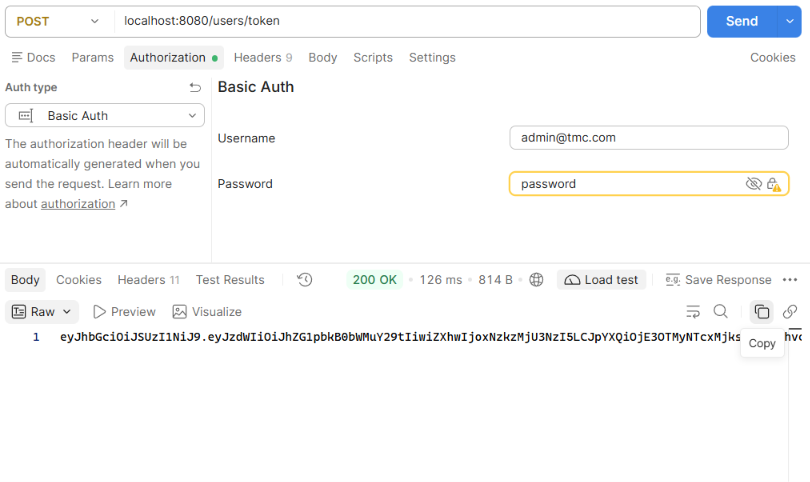
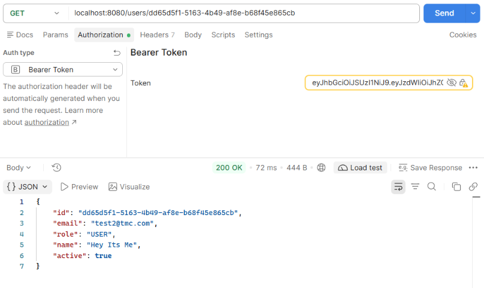

# QR code-based Attendance and Access Control System

A Java - Spring Boot implementation for 2 services of the serviced-based architecture style:

1. User & attendance service
2. QR & access service

## How to run

1. Generate RSA key pair (for JWT):

    ```bash
    openssl genrsa > private.key
    openssl rsa -in private.key -pubout -out public.key
    ```

2. Copy the keys to resources folders:

    ```bash
    cp public.key private.key attendance/src/main/resources/
    cp public.key access/src/main/resources/
    rm public.key private.key
    ```

3. Start the database and kafka containers:

    ```bash
    docker compose up -d
    ```

4. Run the 2 services (on 2 terminal):

    Terminal 1

    ```bash
    cd attendance && ./gradlew bootRun
    ```

    Terminal 2
    ```bash
    cd access && SPRING_PROFILES_ACTIVE=demo ./gradlew bootRun
    ```

Now you can send request to service Attendance (`localhost:8080`) and service Access (`localhost:8081`) through an API client like Postman.

## Run everything in containers

Instead of steps 2 to 4, the two services can run in containers behind an Nginx reverse proxy:

1. Put the key pair from step 1 in the `keys` folder (the keys are mounted into the containers, they are not copied into the images):

    ```bash
    mv public.key private.key keys/
    ```

2. Create the test certificates in the `certs` folder (a local certificate authority, the Nginx server certificate and one Kiosk client certificate):

    ```bash
    ./scripts/generate-certs.sh
    ```

3. Build and start the database, Kafka, both services and Nginx:

    ```bash
    docker compose --profile app up -d --build
    ```

All requests then go through Nginx at `https://localhost:8443`: `/users` and `/attendances` are routed to service Attendance, `/qr-codes` to service Access. Clients must trust `certs/ca.crt`.

Scanning a QR code (`POST /qr-codes`) is done by a Kiosk, which has no user account: the request needs no JWT but must present a client certificate signed by the certificate authority. Every other request uses a JWT as before.

```bash
curl --cacert certs/ca.crt --cert certs/kiosk.crt --key certs/kiosk.key \
    -H 'Content-Type: application/json' -X POST https://localhost:8443/qr-codes \
    -d '{"content": "<scanned content>", "event": "CHECK_IN"}'
```

When service Access runs without Nginx (steps 2 to 4), send the header `X-Client-Verify: SUCCESS` with `POST /qr-codes` instead; Nginx sets this header after it has verified the certificate.

Stop everything with `docker compose --profile app down`.

Service Access exposes `/actuator/health`, `/actuator/health/liveness` and `/actuator/health/readiness` without authentication. They are not routed by Nginx, so they are reachable only inside the Docker network. In the containers it writes JSON log lines that carry a `requestId`, the same id that Nginx writes as `rid` in its access log. See the logs with `docker compose logs access nginx`.

## Code quality checks (service Access)

```bash
cd access
./gradlew spotlessApply   # fix formatting
./gradlew build           # compile, formatting, Checkstyle, SpotBugs, package
./gradlew test --tests '*Test'   # unit tests that need no database or broker
./gradlew integrationTest        # starts PostgreSQL and Kafka in containers, needs Docker running
```

The rules are in `access/config/checkstyle/checkstyle.xml`. Warnings of SpotBugs that were judged to be false positives are listed with their reason in `access/config/spotbugs/exclude.xml`.

Settings that differ between environments are read from environment variables, with defaults for local development: `DB_URL`, `DB_USERNAME`, `DB_PASSWORD`, `KAFKA_BOOTSTRAP_SERVERS`, `JWT_PUBLIC_KEY`, `JWT_PRIVATE_KEY` and `TURNSTILE_API_BASE_URL`. Service Access needs `TURNSTILE_API_BASE_URL` to start. The exception is the `demo` profile (used in the commands above): with it and an empty `TURNSTILE_API_BASE_URL`, the service only logs the request to open a gate, and the `/qr-codes/test-kafka` endpoint is available.

## Send requests with Postman

1. Login with the system generated ADMIN account with Basic Auth, and copy the response JWT: 
    
    - Username: `admin@tmc.com`
    - Password: `password`

    

2. Use the copied JWT to authenticate every other requests with Bearer Token (the JWT is valid for 10 minutes)

    


