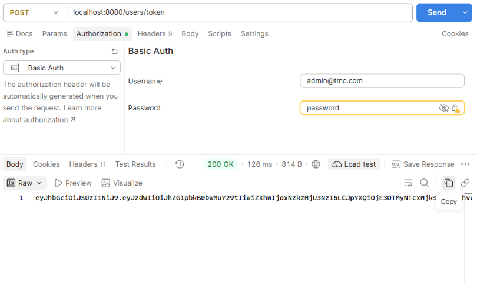
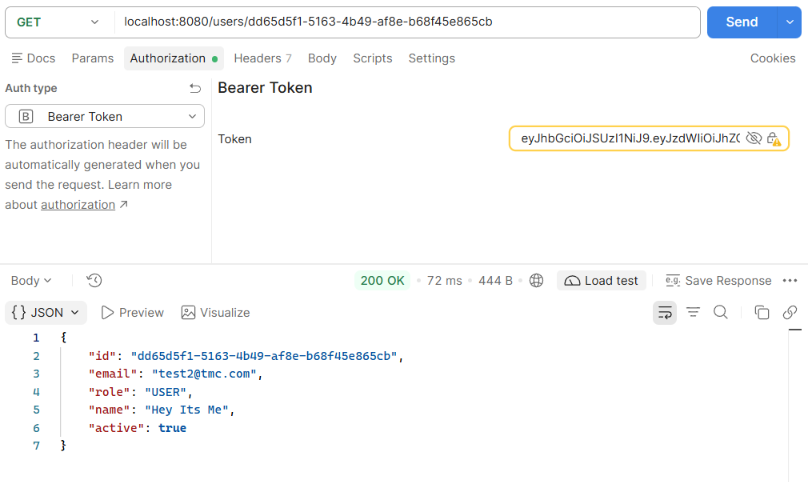

# QR code-based Attendance and Access Control System

A Java - Spring Boot implementation for 2 services of the serviced-based architecture style:

1. User & attendance service
2. QR & access service

## How to run

1. Generate RSA key pair (for JWT):

    ```bash
    openssl genrsa > private.key
    openssl rsa -in private.key -pubout -out public.key
    ```

2. Copy the keys to resources folders:

    ```bash
    cp public.key private.key attendance/src/main/resources/
    cp public.key access/src/main/resources/
    rm public.key private.key
    ```

3. Start the database and kafka containers:

    ```bash
    docker compose up -d
    ```

4. Run the 2 services (on 2 terminal):

    Terminal 1

    ```bash
    cd attendance && ./gradlew bootRun
    ```

    Terminal 2
    ```bash
    cd access && ./gradlew bootRun
    ```

Now you can send request to service Attendance (`localhost:8080`) and service Access (`localhost:8081`) through an API client like Postman.

## Send requests with Postman

1. Login with the system generated ADMIN account with Basic Auth, and copy the response JWT: 
    
    - Username: `admin@tmc.com`
    - Password: `password`

    

2. Use the copied JWT to authenticate every other requests with Bearer Token (the JWT is valid for 10 minutes)

    


